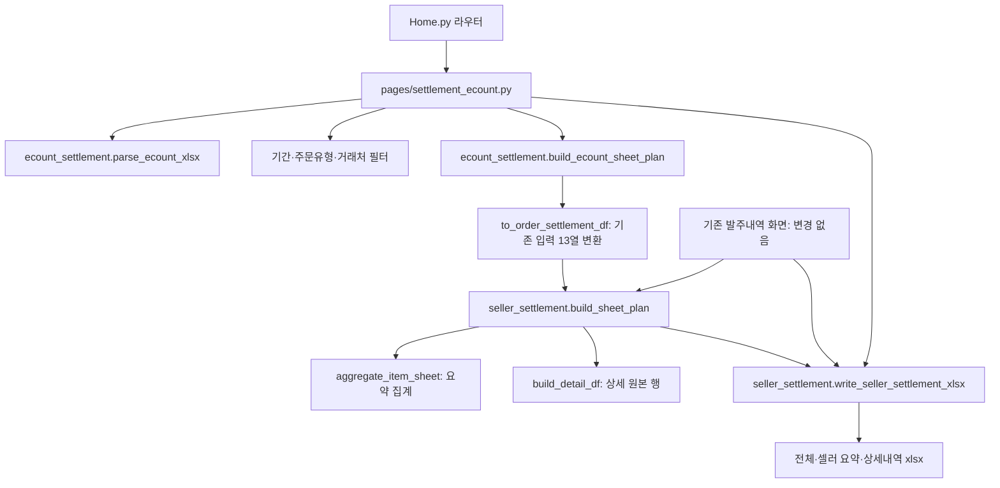
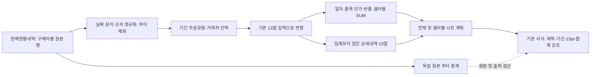
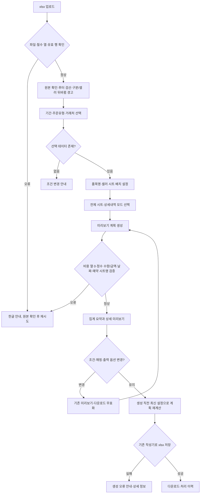

# 이카운트 정산서 출력 양식 통일

2026-10-13 hoyeon.han

## 확정 규칙

원본만 이카운트 판매현황내역으로 사용하고, 집계·상세내역·엑셀 서식은 기존 발주내역 정산서 기능을 재사용한다. 기존 발주내역 모듈과 화면은 수정하지 않는다.

- 요약 6열: 작성일자, 품목, 수량, 단가, 합계, 비고.
- 집계 키: 일자 + 매핑된 품목 + 행 금액/수량 단가(소수 4자리) + 수량 음수 여부 + 셀러.
- 수량과 금액을 합산한다. 다른 단가·셀러·반품은 합치지 않는다.
- 금액 기준은 원본 합계다. 세율을 추정하거나 원본 단가로 금액을 역산하지 않는다.
- 수량 0의 금액은 단가 0 그룹으로 보존한다. 음수 반품도 보존한다.
- 수량·금액은 기존 정산서와 같은 정수 단위만 지원한다. 소수 수량·금액이나 무한값은 총계 변경을 막기 위해 생성 중단한다. 계산 단가의 소수는 지원한다.
- 원본 단가는 파싱 데이터에 보존하지만 요약 출력 단가는 기존 계산 방식을 사용한다.
- 배송비·도선료 별도 품목 행은 유지한다. 비용 컬럼에서 다시 추가하지 않는다.
- 원본 비용 열에 0이 아닌 금액이 있으면 포함 관계를 추정하지 않고 생성을 중단한다.
- 셀러 없는 행은 기존 발주내역 화면처럼 일반으로 포함한다. 연락처2가 없으면 빈칸이다.
- 상세내역은 집계하지 않은 원본 주문 행이며, 품목명 매핑은 요약과 동일하게 적용한다.

## 1. 프로그램 구조

## 2. 데이터 구조와 흐름

### 컬럼 대응

| 이카운트 | 기존 상세내역 | 처리 |
|---|---|---|
| 작성일자(원본 일자) | 출고일 | 날짜형 정규화 |
| 회사명(원본 거래처명) | 업체명 | 거래처 |
| 구분 | 구분 | 발주·반품 등 주문유형 |
| 수하인명 / 수하인주소 | 수하인명 / 수하인주소 | 원본 정보 |
| 품목(원본 품목명) | 제품 | 요약과 같은 품목 매핑 |
| 연락처1 / 연락처2 | 연락처1 / 연락처2 | 없는 연락처2는 빈칸 |
| 비고(원본 특이사항) | 특이사항 | 셀러, 빈 값은 일반 |
| 수량 | 수량 | 음수·0 포함 |
| 합계 | 상품매출 | 원본 정산금액 전액 |
| 배송비·도선료 품목 행 | 제품·상품매출 | 별도 행 유지 |
| 배송비 / 도선료 비용 열 | 판매배송비 / 도선료 | 0인 양식만 지원, 추가 계상 없음 |

상세내역 열 순서: 출고일, 업체명, 구분, 수하인명, 수하인주소, 제품, 연락처1, 연락처2, 특이사항, 수량, 상품매출, 판매배송비, 도선료.

상세 서식: 열별 금액 합계 → 빈 2행 → 총합계. 비용 0은 빈칸 표시, A2 틀 고정.

## 3. 실행 및 예외 흐름

파싱 시 잘못된 날짜는 기존 규칙대로 제외 건수를 안내한다. 출력 변환 단계에 잘못된 날짜가 남으면 생성 중단한다. 푸터 불일치는 기존 화면에서 경고한다. 구분/셀러를 자동 치환하지 않는다.

## 주요 용어

| 용어 | 의미 |
|---|---|
| 구분 | 주문유형. 필터 및 상세내역에 사용 |
| 특이사항 / 비고 | 셀러명. 요약 비고·시트 배치 기준 |
| 요약 | 기존 집계 키별 수량·금액 합산 |
| 단가 | 원본과 구별되는 정산 요약 단가, 행 합계/수량 |
| 상세내역 | 집계 전 주문과 수하인·연락처·주소 정보 |
| 전체 | 선택 조건 전체 요약. 셀러 요약과 중복이므로 다시 합산하지 않음 |
| 일반 | 셀러가 없거나 일반 시트로 배치된 행 |
| 시트 계획 | 요약·상세·전체 DataFrame과 상세 생성 모드를 담은 dict |

## 구현 목록과 검증

1. Src/ecount_settlement.py: 원본 비용·연락처2 보존, 13열 입력 변환, 공유 시트 계획 연결.
2. pages/settlement_ecount.py: 상세정보 유지, 출력 옵션, 집계/상세 미리보기, 최신 설정 재계산, 기존 작성기 연결.
3. tests/test_ecount_settlement.py: 합성 데이터 회귀 검증 및 기존 파서 검증 유지.
4. Src/settlement.py, Src/seller_settlement.py, 기존 발주내역 화면은 변경하지 않는다.
5. 기존 구현은 주석으로 보존하고 변경 위치에 날짜·작성자를 남긴다.

2026년 9월 시온프로젝트 첨부파일 기준: 원본 주문 834행, 전체 요약 47행, 수량 822개, 금액 192,823,700원. 셀러 요약 6장·전체 1장·상세내역 1장으로 기본 8개 시트다. 개인정보 원본과 출력 엑셀은 Git에 포함하지 않는다.

검증 대상: 원본 푸터·전체 요약·셀러별 합계·상세 총합계 일치, 상세 834행 일대일 보존, 음수 반품과 0 수량 금액 보존, 소수 단가 정밀도, 배송비 별도 행 중복 없음, 6열/13열 서식, 매핑 변경 후 재생성, 상세 생성 3모드.

최종 실행 결과: 전체 테스트 141건 통과, 이카운트 단독 98건 통과. 개인정보 샘플이 없는 조건에서는 71건 통과·27건 건너뜀. 실제 화면의 기본 생성·품목 매핑 변경·이전 결과 무효화·상세 3모드·전체 제외·주문유형 변경을 검증했고, 출력 8개 시트와 합계행을 렌더링하여 확인했다.
