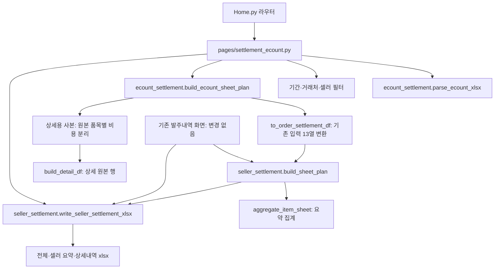
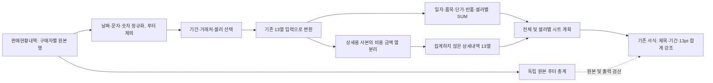
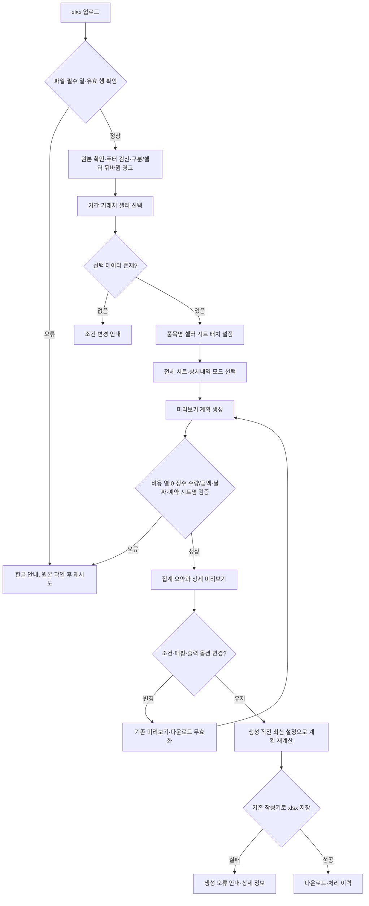

# 이카운트 정산서 출력 양식 통일

2026-10-13 hoyeon.han

<!-- 2026-11-05 hoyeon.han: 매출 상세와 매입 요약의 문서 범위를 구분한다.
2026-11-04 hoyeon.han: 이카운트 상세내역에서 별도 품목 행의 배송비·도선료를
각 비용 열로 분리한다. 아래 규칙과 컬럼 대응은 이 변경을 반영한 현재 기준이다.
-->
2026-11-04 hoyeon.han: 이카운트 매출 상세내역에서 별도 품목 행의 배송비·도선료를
각 비용 열로 분리한다. 아래 13열 상세 설계와 비용 분류는 매출 기준이다.

<!-- 2026-11-05 hoyeon.han: 기술 문서의 정식 위치와 매출·매입 지원 범위를 기록한다. -->
## 문서 범위와 소스 위치

이 기술 문서는 `docs/settlement/`에서 Git으로 관리합니다. 실행 코드와 테스트는 `Src/`, `pages/`, `tests/`에 두며 보관 기준은 [소스와 로컬 자료 관리](../development/source-layout.md)를 따릅니다. 아래 날짜별 테스트 수치와 샘플 결과는 당시 기록이며 이번 경로 정리의 새 실행 결과가 아닙니다. 원본 Excel·출력·화면·보고서는 로컬 `.codex/` 또는 기존 업무자료 경로에 보존하며 Git에 포함하지 않습니다.

| 정산서 종류 | 원본 | 출력 |
|---|---|---|
| 매출 | `판매현황내역` | 셀러 요약, 선택한 전체 시트, 선택한 상세 모드 |
| 매입 | `구매현황내역` | 셀러 요약과 선택한 전체 시트. 상세내역 없음 |

매입은 원본 합계를 사용하고 공급가액+부가세와 대조합니다. 합계 열이 없으면 공급가액+부가세로 정산금액을 구성합니다. 수량·반품을 유지하며 금액이 모두 공란인 행은 수량을 포함하고 금액 0원으로 안내합니다. 서버에는 `Src/ecount_file_store.py`를 통해 판매·구매 최신 원본을 각각 하나씩 보관합니다. 유형이 다른 원본이나 지원하지 않는 금액·수량은 저장 전에 거부하여 기존 저장본을 유지합니다.

매출 상세 비용은 원본 행을 유지한 채 상품매출에서 전용 비용 열로 옮깁니다. 첫 상품행으로 병합하지 않습니다. 아래 프로그램 구조·13열 대응·상세 모드는 매출 경로에 적용합니다. 실제 선택 단계는 기간·거래처·셀러이며 주문유형은 전체 포함합니다.

## 확정 규칙

원본만 이카운트 판매현황내역으로 사용하고, 집계·상세내역·엑셀 서식은 기존 발주내역 정산서 기능을 재사용한다. 기존 발주내역 모듈과 화면은 수정하지 않는다.

- 요약 6열: 작성일자, 품목, 수량, 단가, 합계, 비고.
- 집계 키: 일자 + 매핑된 품목 + 행 금액/수량 단가(소수 4자리) + 수량 음수 여부 + 셀러.
- 수량과 금액을 합산한다. 다른 단가·셀러·반품은 합치지 않는다.
- 금액 기준은 원본 합계다. 세율을 추정하거나 원본 단가로 금액을 역산하지 않는다.
- 수량 0의 금액은 단가 0 그룹으로 보존한다. 음수 반품도 보존한다.
- 수량·금액은 기존 정산서와 같은 정수 단위만 지원한다. 소수 수량·금액이나 무한값은 총계 변경을 막기 위해 생성 중단한다. 계산 단가의 소수는 지원한다.
- 원본 단가는 파싱 데이터에 보존하지만 요약 출력 단가는 기존 계산 방식을 사용한다.
<!-- 2026-10-13 규칙: 배송비·도선료 별도 품목 행은 유지한다. 비용 컬럼에서 다시 추가하지 않는다. -->
- 배송비·도선료 별도 품목 행과 기존 요약 집계는 유지한다. 상세내역에서만 각 행의
  상품매출을 0으로 두고 원래 금액을 판매배송비 또는 도선료 열로 옮긴다.
- 비용 분류는 품목명 매핑 전의 원본 품목을 기준으로 한다. 표시명 변경으로 비용이
  상품으로 바뀌거나 일반 상품이 비용으로 분류되지 않는다. 음수와 수량 0도 보존한다.
- 전체 하나로/셀러별 상세 모두 같은 규칙을 적용한다. 셀러별 시트명은 기존 계획을 유지한다.
- 상세 미리보기의 금액 합계는 상품매출 + 판매배송비 + 도선료다.
- 원본 비용 열에 0이 아닌 금액이 있으면 포함 관계를 추정하지 않고 생성을 중단한다.
- 셀러 없는 행은 기존 발주내역 화면처럼 일반으로 포함한다. 연락처2가 없으면 빈칸이다.
- 상세내역은 집계하지 않은 원본 주문 행이며, 품목명 매핑은 요약과 동일하게 적용한다.

## 1. 프로그램 구조



## 2. 데이터 구조와 흐름



### 컬럼 대응

<!-- 2026-10-13 대응: 합계 전체를 상품매출에 넣고 배송비·도선료 품목 행도 제품·상품매출로 유지했다. -->

| 이카운트 | 기존 상세내역 | 처리 |
|---|---|---|
| 작성일자(원본 일자) | 출고일 | 날짜형 정규화 |
| 회사명(원본 거래처명) | 업체명 | 거래처 |
| 구분 | 구분 | 발주·반품 등 주문유형 |
| 수하인명 / 수하인주소 | 수하인명 / 수하인주소 | 원본 정보 |
| 품목(원본 품목명) | 제품 | 요약과 같은 품목 매핑 |
| 연락처1 / 연락처2 | 연락처1 / 연락처2 | 없는 연락처2는 빈칸 |
| 비고(원본 특이사항) | 특이사항 | 셀러, 빈 값은 일반 |
| 수량 | 수량 | 음수·0 포함 |
| 일반 품목 행의 합계 | 상품매출 | 원본 정산금액 |
| 배송비 품목 행의 합계 | 판매배송비 | 별도 행 유지, 상품매출은 0 |
| 도선료 품목 행의 합계 | 도선료 | 별도 행 유지, 상품매출은 0 |
| 배송비 / 도선료 비용 열 | 판매배송비 / 도선료 | 0인 양식만 지원, 추가 계상 없음 |

상세내역 열 순서: 출고일, 업체명, 구분, 수하인명, 수하인주소, 제품, 연락처1, 연락처2, 특이사항, 수량, 상품매출, 판매배송비, 도선료.

상세 서식: 열별 금액 합계 → 빈 2행 → 총합계. 비용 0은 빈칸 표시, A2 틀 고정.

요약용 `to_order_settlement_df()`는 기존과 같이 합계 전액을 상품매출에 대응한다.
`build_ecount_sheet_plan()`이 요약 계획을 만든 뒤 상세용 사본만 비용을 분리한다.
이 사본을 요약 집계에 다시 넣지 않으므로 비용 중복 계상과 음수 비용 누락을 피한다.

## 3. 실행 및 예외 흐름



파싱 시 잘못된 날짜는 기존 규칙대로 제외 건수를 안내한다. 출력 변환 단계에 잘못된 날짜가 남으면 생성 중단한다. 푸터 불일치는 기존 화면에서 경고한다. 구분/셀러를 자동 치환하지 않는다.

## 주요 용어

| 용어 | 의미 |
|---|---|
<!-- 2026-11-05 hoyeon.han: 현재 주문유형 전체 포함 정책을 안내한다.
| 구분 | 주문유형. 필터 및 상세내역에 사용 |
-->
| 구분 | 주문유형. 매출 상세에 표시하며 정산 시 전체 유형을 포함 |
| 특이사항 / 비고 | 셀러명. 요약 비고·시트 배치 기준 |
| 요약 | 기존 집계 키별 수량·금액 합산 |
| 단가 | 원본과 구별되는 정산 요약 단가, 행 합계/수량 |
| 상세내역 | 집계 전 주문과 수하인·연락처·주소 정보 |
| 전체 | 선택 조건 전체 요약. 셀러 요약과 중복이므로 다시 합산하지 않음 |
| 일반 | 셀러가 없거나 일반 시트로 배치된 행 |
| 시트 계획 | 요약·상세·전체 DataFrame과 상세 생성 모드를 담은 dict |

## 구현 목록과 검증

1. Src/ecount_settlement.py: 원본 비용·연락처2 보존, 13열 입력 변환, 공유 시트 계획 연결.
2. pages/settlement_ecount.py: 상세정보 유지, 출력 옵션, 집계/상세 미리보기, 최신 설정 재계산, 기존 작성기 연결.
3. tests/test_ecount_settlement.py: 합성 데이터 회귀 검증 및 기존 파서 검증 유지.
4. Src/settlement.py, Src/seller_settlement.py, 기존 발주내역 화면은 변경하지 않는다.
5. 기존 구현은 주석으로 보존하고 변경 위치에 날짜·작성자를 남긴다.

2026년 9월 시온프로젝트 첨부파일 기준: 원본 주문 834행, 전체 요약 47행, 수량 822개, 금액 192,823,700원. 셀러 요약 6장·전체 1장·상세내역 1장으로 기본 8개 시트다. 개인정보 원본과 출력 엑셀은 Git에 포함하지 않는다.

검증 대상: 원본 푸터·전체 요약·셀러별 합계·상세 총합계 일치, 상세 834행 일대일 보존, 음수 반품과 0 수량 금액 보존, 소수 단가 정밀도, 배송비 별도 행 중복 없음, 6열/13열 서식, 매핑 변경 후 재생성, 상세 생성 3모드.

최종 실행 결과: 전체 테스트 141건 통과, 이카운트 단독 98건 통과. 개인정보 샘플이 없는 조건에서는 71건 통과·27건 건너뜀. 실제 화면의 기본 생성·품목 매핑 변경·이전 결과 무효화·상세 3모드·전체 제외·주문유형 변경을 검증했고, 출력 8개 시트와 합계행을 렌더링하여 확인했다.

## 2026-11-04 상세 비용 열 수정

- 원인: 상세 변환에서 비용 열을 항상 0으로 두었고, 공용 작성기가 비용 0을 빈칸으로 표시했다.
- 변경: 이카운트 계획 생성과 미리보기 합계만 수정한다. 공용 정산서 집계·작성기는 그대로 사용한다.
- 회귀 검증: 상세 3모드 × 전체 시트 포함/제외, 여러 셀러와 일반, 통합 요약 배치,
  비연속·중복 인덱스, 품목명 변경, 음수 비용과 수량 0, 원본 불변 및 요약 완전 일치.
- 생성한 Excel을 다시 열어 비용 셀·열별 합계·총합계를 확인하고, AppTest로 두 상세 모드의
  상세 탭 금액과 보호된 다운로드 파일을 확인한다.
- 위 2026-10-13 실행 수치는 당시 기록이다. 이번 실행 결과는 별도 검증 기록에 남긴다.

2026-11-04 검증 결과: 샘플 없는 독립 checkout은 101건 통과·27건 건너뜀,
기존 로컬 샘플을 읽기 전용으로 연결한 실행은 이카운트 전체 128건 통과다.
추가한 비용 회귀의 수정 전 실행은 7건 실패·2건 통과로 기존 문제를 재현했다.
전체 4,561행 샘플을 실제 Excel로 생성해 다시 읽었고, 단일 상세 1장과 셀러별
상세 42장 모두 상품매출 930,883,441원·배송비 448,800원·도선료 120,000원,
총액 931,452,241원 및 행 수 보존을 확인했다. 임시 출력은 확인 후 삭제했다.
화면 검증은 인증을 포함한 AppTest이며 실제 브라우저·운영 배포 검증은 수행하지 않았다.

<!-- 2026-11-05 hoyeon.han: 경로 이동 후 구매 검증 진입점을 안내한다. -->
매입·최신 원본 저장은 `tests/test_ecount_purchase_settlement.py`, 매출 상세·기존 파서 회귀는 `tests/test_ecount_settlement.py`에서 검증합니다. 프로젝트 루트의 가상환경에서 다음과 같이 실행합니다. 개인정보 샘플이 없는 checkout에서는 해당 샘플 검사만 생략하고 합성 회귀는 실행합니다.

```bash
.venv311/bin/python -m pytest -q tests/test_ecount_settlement.py tests/test_ecount_purchase_settlement.py
```
